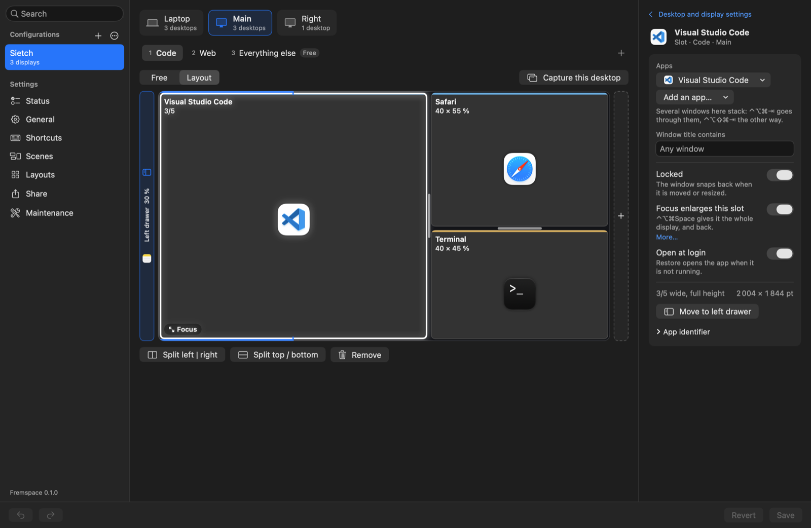
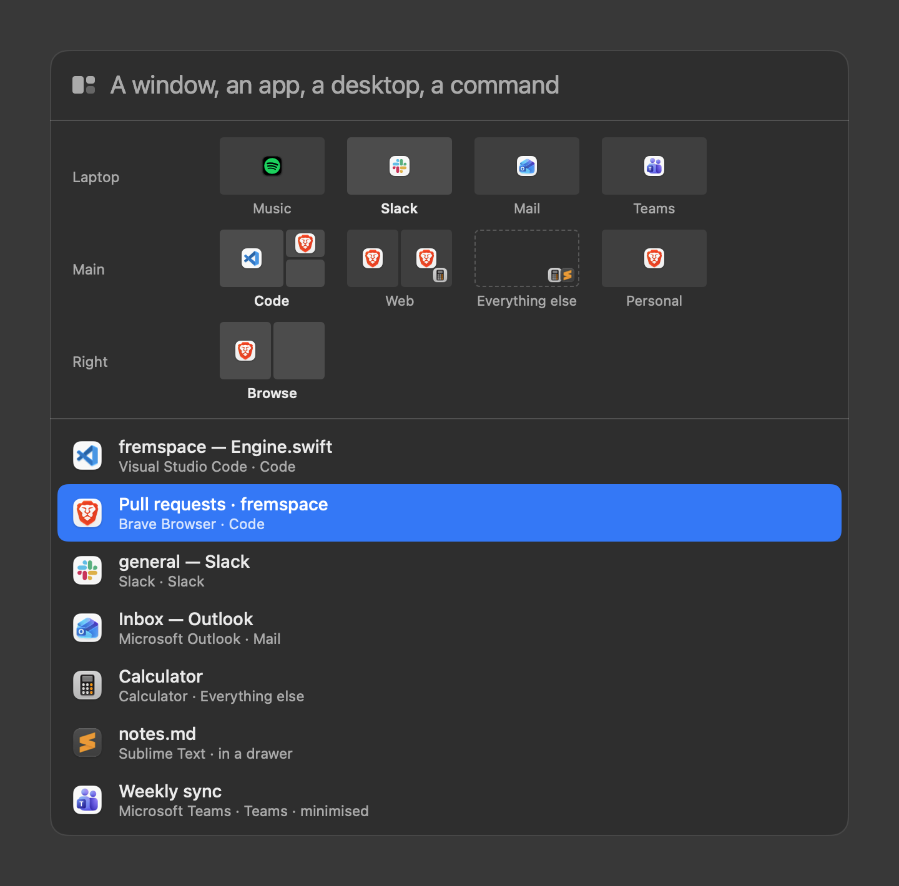

# Fremspace

A window manager for macOS. Every desktop (Space) of every display has a layout of slots; apps open
in their slot, stay there, and are all back where they were after a restart.

<https://fremspace.app>



## What it does

- **A layout for each desktop.** Split a desktop into slots and say which apps live where. A window
  that opens goes to its slot, on its desktop, on its display. A locked slot takes its window back
  when you drag it away.
- **Focus.** One shortcut gives a slot the whole desktop; the same shortcut puts everything back.
- **Stacks.** Several windows share a slot, and a shortcut goes through them.
- **Side by side.** One shortcut opens a second window of the app in front and puts the two half
  and half in its slot; the same shortcut stacks them again.
- **Drawers.** Windows parked off the side of a display, slid in when you need them.
- **Back after a restart.** At login Fremspace opens the apps that have a slot and puts every window
  back on the right desktop.
- **One setup per set of displays.** The desk, the laptop alone, another office: the configuration
  that matches the connected displays is applied. A travel version turns the slots of the big
  displays into desktops of the laptop. Displays take the name you give them ("Main", "Right").
- **A palette** (⌃⌥⌘K) that finds an open window on any desktop, an app, a desktop, a scene or a
  command, over a map of every desktop that the arrow keys go through.
- **Scenes** that switch several displays to their desktops at once, and can put a slot in Focus,
  open or close a drawer and open apps; asking for a scene again leaves it and goes back to what
  the displays showed.
- **The notch.** A desktop's name hangs from it when a display changes desktop, and resting the
  pointer on it opens the map of desktops.
- **Window previews**, if you switch them on: the palette, the maps and the editor show a picture
  of each window.
- **Calls in full screen.** The meeting window of Microsoft Teams or Zoom goes to full screen when
  the call starts.
- **Hyper key.** Caps Lock can stand for ⌃⌥⌘, with nothing else to install.
- **Layouts to share.** A configuration as one file to post, and somebody else's added beside
  yours, from a library of layouts.
- **`fremspace://` links** for launchers, button decks and scripts: `open -g fremspace://desktop/Web`.



## Install

Download `Fremspace.dmg` from the [latest release](https://github.com/fdussert/fremspace/releases/latest),
drag Fremspace to Applications, launch it and allow Accessibility when macOS asks. It lives in the
menu bar. macOS 13 or later, Apple silicon and Intel; sending a window to another desktop needs
macOS 26.4 or later. Updates arrive by themselves (Sparkle, signed by the project), or with
**Check for Updates…** in the menu.

Or build it, with the Command Line Tools and nothing else (no Xcode, no SwiftPM):

```sh
scripts/create-signing-identity.sh   # once: a stable local identity, so the Accessibility
                                     # grant survives rebuilds
scripts/build.sh                     # dist/Fremspace.app
open dist/Fremspace.app
```

## Before you install

- **Accessibility.** Fremspace reads and moves other apps' windows, which is what that permission is
  for. It does nothing without it.
- **One request, for updates.** No account and no telemetry. About once a day the downloaded app
  fetches one file, `appcast.xml`, from this project's GitHub releases, to learn whether a newer
  version exists; it sends nothing but the request itself (Sparkle's system profile is off), and
  the switch is on the General page. An app built from a checkout has no updater and makes no
  request at all. The configuration is one JSON file,
  `~/Library/Application Support/Fremspace/config.json`, next to what Fremspace remembers
  (`state.json`).
- **Private parts of macOS.** macOS has no public way to send a window to another desktop, to read
  which desktop a display shows, or to add a desktop. Fremspace uses the window server's own calls
  for these, so a macOS update can break it until Fremspace is updated; its Status page says so
  when it happens. This is also why it cannot be on the Mac App Store. The call that sends a window
  to another desktop exists since macOS 26.4: on an older macOS Fremspace arranges the windows on
  the desktop where they are. It is developed and tried on macOS 27, and on no older version yet.
- **Window previews** are off unless you switch them on. They need a second permission, Screen
  Recording, which macOS asks for at that moment; the pictures stay in memory and are never written
  or sent anywhere.
- **The map under the notch** is on unless you switch it off, on a Mac with a notch. While it is
  open Fremspace filters key presses too: with the pointer on the map, the arrow keys, Return and
  Escape are the map's; every other key goes to the app in front.
- **The Hyper key** is off unless you switch it on. While on, Caps Lock is remapped in the system and
  Fremspace filters key presses to read it; the mapping is removed when Fremspace quits.
- **If Fremspace crashes.** Two things wait for it to start again, which puts both right: with the
  Hyper key on, Caps Lock does nothing (it comes back by itself when you log out); and the windows
  of a closed drawer stay parked off the side of their display.

## Using it

Open the editor from the menu bar icon (or ⌃⌥⌘,). Make a configuration from the connected displays,
split a desktop into slots, choose the apps, Save. "Capture this desktop" starts from the windows
as they are now. Every shortcut is on the Shortcuts page and can be changed; they all begin with
⌃⌥⌘ by default.

| | |
|---|---|
| Open the palette | ⌃⌥⌘K |
| Focus a slot, and back | ⌃⌥⌘Space |
| Go to the slot beside | ⌃⌥⌘ ← → ↑ ↓ |
| Swap two slots | ⌃⌥⇧⌘ ← → ↑ ↓ |
| Next window of a stack | ⌃⌥⌘⇥ |
| Two windows of the app side by side, and back | ⌃⌥⌘S |
| Open the left, the right drawer | ⌃⌥⌘L, ⌃⌥⌘D |
| Send the window to the left, the right drawer | ⌃⌥⇧⌘L, ⌃⌥⇧⌘D |
| Show a scene | ⌃⌥⌘1 … 4 |
| Put every window back | ⌃⌥⌘R |
| Pause | ⌃⌥⌘P |
| The commands for the window in front | ⌃⌥⌘W |

The window in front can also take a half, a third or two thirds of its display, the whole of it or
its centre: these are in that menu of commands, and have no shortcut until you give them one on the
Shortcuts page (⌃⌥ and a key is what other window tools already use).

## Share your desk

A desk worth a photo is worth a file. **Share → Export** in the editor writes the configuration to
a `.fremspace-layout.json`: the desktops, their layouts, the drawers and the scenes. The page shows
what is in the file first. Never in it: the models and serial numbers of your displays, your
shortcuts, what Fremspace remembers about your windows. Browser profiles and window title filters
go in only if you tick them. Post the file with a screenshot in the repository's
**Discussions → Show and tell**.

To use somebody else's, **Share → Add a layout**: choose which of your displays takes each display
of the file, and its desktops come after yours, with its scenes. Nothing of yours is replaced, and
nothing changes until you save. Layouts kept in the library
(`~/Library/Application Support/Fremspace/Layouts/`) are listed there, ready to add. The details
are in `docs/sharing.md`.

## Working on it

```sh
scripts/test.sh    # FremspaceCore's unit tests (XCTest syntax on a small shim)
scripts/build.sh   # dist/Fremspace.app
```

`Sources/FremspaceCore` holds the rules (layouts, routing, matching, geometry) with no AppKit, and
is what the tests cover. `Sources/Fremspace` is the app: Accessibility, the window server, the
editor. What was found about the window server's private calls is in `docs/spikes`, the layout file in
`docs/sharing.md`, the release procedure in `docs/releasing.md`, and what changed in `CHANGELOG.md`. See `CONTRIBUTING.md` before sending a change and `SECURITY.md`
to report a vulnerability.

## License

MIT. See `LICENSE`.
